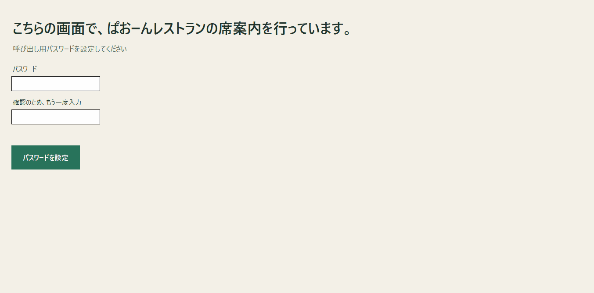

# my-projects

## paooooonのプログラミング作品集

2026年から作ってきたPythonとmicrobitの学習・制作アーカイブです！

## 1.ぱおーんレストラン席案内（2026年10月作成）
-使ったもの：python

### 何故受付機を作ったのか
受付にした理由は、最初、注文にしようかと思ったけど、注文は、時によって個数も違うし、メニューの写真なども入れないといけないし、値段を変えたときは、変更が必要などがあるからです。受付機は、一度作れば、どのお店でも使えるし、値段などを入れる必要がないからです。

### 工夫したところ
受付をした後、「お待ちください」で空席の呼び出しを押すと、パスワードがなければ、すぐいけてしまうので、パスワード式にしたところです。
最初はスクラッチで作りました。スクラッチでは、ブロックを見ればすぐパスワードがなにかがわかってしまうので、パスワードの意味がないのですが、
Pythonなら操作画面にはパスワードが表示されないから、Pythonで作りました。

### 操作デモ：

##2.〇〇〇〇（202〇年〇月作成）
-使ったもの：python,micro:bit
-工夫した点：
-写真：

##3.〇〇〇〇（202〇年〇月作成）
-使ったもの：python,micro:bit
-工夫した点：
-写真：
